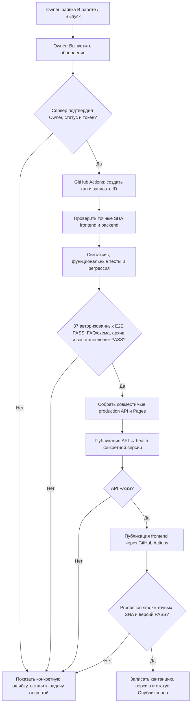

# Центр доработок · автоматизированный выпуск · 22.11.2026

Связь с реестром замечаний: [#166](https://github.com/hakaru4i-afk/freight-quotes-web/issues/166). Приоритет: критический. Затронуты кабинет Владельца, API Supabase, GitHub Actions, GitHub Pages и инженерный журнал. Рабочее разрешение Владельца — 22.11.2026. Публикация требует отдельного решения и обязательных проверок.

## RU — инструкция Владельца
В Центре доработок выберите заявку со статусом «В работе» либо «Выпуск» и нажмите **«Выпустить обновление»**. Повторное нажатие не создаёт параллельный выпуск. Сервер удостоверяет роль Владельца, записывает заявку в журнал и пытается передать её в защищённый workflow `owner-portal-release.yml`. После принятия команды отображается «Запрос принят GitHub», ссылка на журнал и текущее состояние. Кнопка запускает проверки, а не немедленно публикует непроверенный код.

При несовместимых исходниках, неуспешных тестах, недоступных полномочиях или отсутствии подтверждённой свежей копии и восстановления выпуск останавливается с причиной в GitHub Actions. Статус «Опубликовано» допустим только после зелёного конечного production smoke, включая API и Pages. Код, данные, GitHub Issue, успешный merge и простой HTTP 200 сами по себе не означают публикацию.

## EN — Owner instructions
Open an in-progress or release-stage request in the Improvement Center, then select **Start release**. The server validates the Owner session, records the action, and requests the protected `owner-portal-release.yml` GitHub workflow. The UI displays the real workflow status and a link to its run. A click starts validation; it does not bypass tests or immediately mark the task complete. Production deploy is blocked until compatible, exact-source checks, authenticated 37-case E2E, a fresh encrypted backup and independent restore evidence pass. Completion means the published frontend **and** backend have been verified.

## ZH — 所有者操作说明
在改进中心选择“进行中”或“发布”状态的任务，点击**启动发布**。服务器确认所有者身份、记录审计并请求受保护的 GitHub Actions 工作流 `owner-portal-release.yml`。界面显示真实状态和运行日志链接。单击仅启动验证，不会绕过测试。前后端版本、37 项认证端到端测试、最新加密备份及独立恢复验证通过后，才允许发布。只有生产 API 与网站均经验证后才显示完成。

## Структура бизнес-процесса E01 (дополнение к P01–P10)

Вся схема E01 доступна Владельцу. Другие роли могут видеть только информацию о доступности портала и затрагивающих их действиях. Изменение относится к инженерному выпуску; процессы перевозки P01–P10 не переименовывались и их бизнес-правила не менялись.

## Релизный контроль
В текущей ветке находится **кандидат**, не доказательство публикации. До merge необходимы проверки авторизации, повторного запуска, отсутствующего токена, RU/EN/ZH, точной связки, опубликованных файлов, протокола отката. Нельзя показывать фиктивный прогресс либо выдавать результат проверок PR за результат production.
