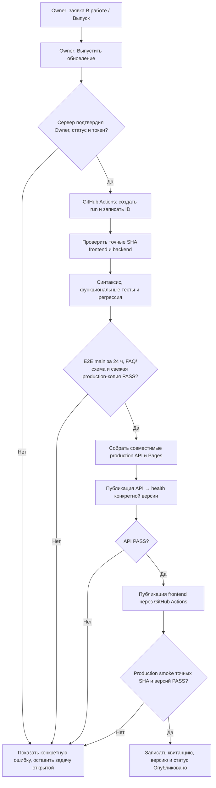

# Центр доработок · автоматизированный выпуск · 22.11.2026

Связь с реестром замечаний: [#166](https://github.com/hakaru4i-afk/freight-quotes-web/issues/166). Приоритет: критический. Затронуты кабинет Владельца, API Supabase, GitHub Actions, GitHub Pages и инженерный журнал. Рабочее разрешение Владельца — 22.11.2026. Публикация требует отдельного решения и обязательных проверок.

## RU — инструкция Владельца
В Центре доработок выберите заявку со статусом «В работе» либо «Выпуск» и нажмите **«Выпустить обновление»**. Повторное нажатие не создаёт параллельный выпуск. Сервер удостоверяет роль Владельца, записывает заявку в журнал и пытается передать её в защищённый workflow `owner-portal-release.yml`. После принятия команды отображается «Запрос принят GitHub», ссылка на журнал и текущее состояние. Кнопка запускает проверки, а не немедленно публикует непроверенный код.

При несовместимых исходниках, неуспешных тестах, недоступных полномочиях или отсутствии подтверждённой свежей копии и восстановления выпуск останавливается с причиной в GitHub Actions. Статус «Опубликовано» допустим только после зелёного конечного production smoke, включая API и Pages. Код, данные, GitHub Issue, успешный merge и простой HTTP 200 сами по себе не означают публикацию.

## EN — Owner instructions
Open an in-progress or release-stage request in the Improvement Center, then select **Start release**. The server validates the Owner session, records the action, and requests the protected `owner-portal-release.yml` GitHub workflow. The UI displays the real workflow status and a link to its run. A click starts validation; it does not bypass tests or immediately mark the task complete. Production deploy is blocked until compatible, exact-source checks, a recent successful main browser E2E (24h) and a fresh encrypted production backup capture pass. Completion means the published frontend **and** backend have been verified.

## ZH — 所有者操作说明
在改进中心选择“进行中”或“发布”状态的任务，点击**启动发布**。服务器确认所有者身份、记录审计并请求受保护的 GitHub Actions 工作流 `owner-portal-release.yml`。界面显示真实状态和运行日志链接。单击仅启动验证，不会绕过测试。前后端版本、24 小时内主分支浏览器端到端测试成功、最新加密生产备份通过后，才允许发布。只有生产 API 与网站均经验证后才显示完成。

## Структура бизнес-процесса E01 (дополнение к P01–P10)

Вся схема E01 доступна Владельцу. Другие роли могут видеть только информацию о доступности портала и затрагивающих их действиях. Изменение относится к инженерному выпуску; процессы перевозки P01–P10 не переименовывались и их бизнес-правила не менялись.

## Релизный контроль
В текущей ветке находится **кандидат**, не доказательство публикации. До merge необходимы проверки авторизации, повторного запуска, отсутствующего токена, RU/EN/ZH, точной связки, опубликованных файлов, протокола отката. Нельзя показывать фиктивный прогресс либо выдавать результат проверок PR за результат production.

## Уточнение индикации / Release progress distinction / 发布进度说明

RU: 100% в «Прогрессе выполнения» означает успешное завершение этапов разработки / PR, **не** четыре независимых подтверждения выпуска. «Ожидаются тесты: X/4» означает frontend, backend, автоматический E2E main (24 ч), encrypted backup; кнопка публикации остаётся отключённой до 4/4. Если кандидат не связан с заявкой, указывается причина, вместо ложной инструкции нажать заблокированную кнопку.

EN: 100% development/PR progress is distinct from 4/4 independent release approvals (frontend, backend, authorized E2E, backup/recovery). A missing candidate is explicitly identified and the release button remains disabled.

ZH: 研发进度 100% 不等于发布验证完成。只有前端、后端、授权端到端测试和备份恢复四项全部确认（4/4）后才启用发布按钮；若未关联发布候选版本，将显示明确原因。

Business-process structure reviewed: release gates remain unchanged. This update changes only UI feedback and does not override Owner permissions or deployment verification.

## Подготовка выпуска / Release preflight / 发布前预检 (2026-11-22)

RU: Владелец при 100% разработки нажимает **«Запустить проверки»**. Защищённый API проверяет Владельца, статус задачи и реальные PR/CI, фиксирует текущие SHA frontend/backend, сохраняет кандидата именно этой заявки и отправляет **только проверочные** GitHub Actions. 4 этапа: frontend, backend, автоматический браузерный E2E main (24 ч) и подтверждённая свежая production-копия. Кнопка «Выпустить обновление» недоступна до 4/4 PASS, и сервер повторно проверяет readiness при запуске. Неподтверждённые тесты не считаются пройденными.

EN: At 100% task progress, Owner selects **Run release checks** to create an exact-SHA task-bound candidate and launch non-deploying checks in both repositories. The publication button and server endpoint remain blocked until four independently verified checks succeed.

ZH: 研发进度达到 100% 后，所有者点击 **运行发布检查**，API 将任务与两个仓库当前精确 SHA 绑定并启动非部署预检。只有四项真实检查全部通过后才允许发布。

Technical process: Owner decision → approved implementation 100% → four-stage nonpublishing preflight → verified 4/4 → Owner release → protected GitHub deployment. Roles other than Owner have no preflight or release permissions.

## Упрощённые проверки / Simplified checks / 简化检查 (2026-11-22)

RU: E2E браузера автоматически запускается GitHub Actions при каждом push в main. Успешный последний запуск за 24 часа засчитывается для следующего выпуска без совпадения SHA. Проверка резервной копии требует успешный за 24 часа реальный запуск шага `capture-and-readback` (шифрованная production-копия); совпадение SHA бэкенда не требуется. Базовые frontend/backend тесты продолжают выполняться. «Запустить проверки» обновляет 4/4, а при PASS показывает «Проверки пройдены, можно выпускать». Запуск выпуска остаётся только по команде Владельца; проверки не публикуют код автоматически.

EN: Browser E2E runs after every main push. The latest successful main push E2E within 24 hours is reusable across commits; backend SHA equality is not required for a successful encrypted production backup captured and read back within 24 hours. Source regression remains mandatory, and only the Owner initiates deployment.

ZH: 每次推送到 main 都会自动运行浏览器端到端测试。24 小时内最近一次成功的主分支测试可复用，无需与发布提交 SHA 相同。备份检查确认 24 小时内实际加密生产备份和回读成功。前后端基础测试和所有者授权发布流程仍然必需。

Процесс E01: задачи → 100% разработки → базовые проверки frontend/backend + последний зелёный E2E main за 24 ч + реальная свежая зашифрованная копия → 4/4 → разрешение кнопки Владельца → выпуск API/Pages с production smoke. Другие процессы P01–P10 не менялись. FAQ кабинета Владельца приведён в соответствие; остальные кабинеты не затронуты.

## ДЕЙСТВУЮЩИЙ ПРОЦЕСС: простой выпуск от 22.11.2026
Предыдущие разделы с обязательными 4/4 проверками, E2E/SHA-квитанциями и запуском предварительных проверок относятся к прежней схеме и более не применяются к обычным обновлениям.
RU: Владелец после 100% проверенного выполнения работы нажимает одну кнопку **«Выпустить обновление»**. Сервер проверяет Owner и факт выполнения задачи. Один GitHub workflow на **self-hosted Mac** выполняет быструю проверку синтаксиса/тестов, собирает и публикует API, затем Pages, проверяет production и фиксирует исход. Никаких бэкапов, Google Drive, полного E2E или точных SHA-сертификатов для обычного релиза. Глубокие E2E запускаются отдельно вручную; аудит бэкапов раз в неделю, вне выпуска. Публикация остаётся только по нажатию Владельца, а не push в main.
EN: After verified 100% task completion, the Owner presses **Start release** once. The server confirms the Owner and completed work, then a self-hosted Mac checks syntax, builds and publishes API and Pages, verifies production, and records the result. Backup/Drive and deep E2E run separately and do not block an ordinary release.
ZH: 当任务完成度达到经验证的 100% 时，所有者只需点击一次**发布更新**。服务器确认所有者权限与任务完成状态，Mac 运行快速语法检测、构建并发布 API 和网页，验证生产结果。备份与深入 E2E 独立运行，不阻止日常发布。
E01 (новая последовательность): 100% задачи → Владелец → один запуск на Mac → быстрые проверки → API → Pages → production-подтверждение → журнал. Бизнес-процессы перевозок P01–P10 не менялись. Тексты кабинета Владельца RU/EN/ZH обновлены.
